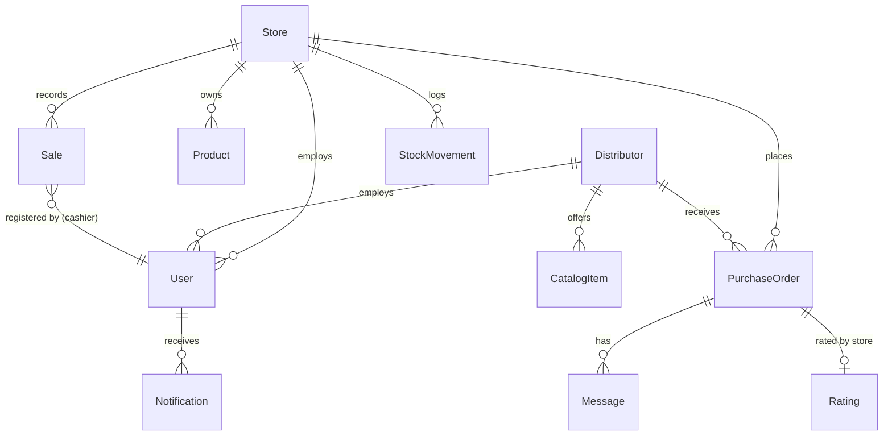

# 03 · Data Model (MongoDB + Mongoose)

All documents have `_id` (ObjectId) and `createdAt` / `updatedAt` (Mongoose timestamps). Money is stored as integer COP. Field names here are the **integration contract**: the frontend, backend and Swagger use exactly these names (camelCase).

## Entity diagram


## Collections

### `stores`
| Field | Type | Rules |
|---|---|---|
| name | String | required, 2–80 chars |
| address | String | required, ≤160 |
| phone | String | required, 7–15 digits |
| owner | ObjectId → users | required |

### `distributors`
| Field | Type | Rules |
|---|---|---|
| name | String | required, 2–80 |
| nit | String | required, unique, `^\d{6,12}(-\d)?$` |
| phone | String | required |
| coverageArea | String | required, ≤120 (e.g. "Chía, Cajicá, Bogotá norte") |
| deliveryDays | Number | required, integer 1–30 |
| minimumOrder | Number | required, integer ≥ 0 (COP) |
| categories | [String] | derived from catalog, for search |
| ratingAverage | Number | default 0, 0–5 |
| ratingCount | Number | default 0 |
| owner | ObjectId → users | required |

### `users`
| Field | Type | Rules |
|---|---|---|
| name | String | required, 2–80 |
| email | String | required, unique, lowercase, valid email |
| passwordHash | String | required, bcrypt cost 12, **never returned** (`select: false`) |
| role | String | enum `store_owner`, `store_inventory`, `store_cashier`, `distributor_owner`, `distributor_staff` |
| orgType | String | enum `store`, `distributor` (derived from role) |
| orgId | ObjectId | required → stores or distributors |
| active | Boolean | default true |
Index: `{ email: 1 }` unique, `{ orgId: 1, role: 1 }`.

### `products` (store inventory)
| Field | Type | Rules |
|---|---|---|
| store | ObjectId → stores | required |
| name | String | required, 2–80 |
| sku | String | required, ≤30, unique per store |
| category | String | required, enum list (see below) |
| unit | String | enum `unit`, `kg`, `g`, `l`, `ml`, `pack` |
| price | Number | required, integer > 0 (sale price) |
| cost | Number | integer ≥ 0 |
| stock | Number | integer ≥ 0 |
| minStock | Number | integer ≥ 0, default 5 |
| lowStockNotified | Boolean | default false (BR3 de-duplication) |
| active | Boolean | default true (soft delete) |
Index: `{ store: 1, sku: 1 }` unique, `{ store: 1, name: "text" }`.

Categories: `groceries`, `beverages`, `dairy`, `snacks`, `cleaning`, `personal_care`, `bakery`, `fruits_vegetables`, `meat`, `other`.

### `sales`
| Field | Type | Rules |
|---|---|---|
| store | ObjectId → stores | required |
| cashier | ObjectId → users | required |
| items | [{ product: ObjectId, name: String, quantity: Int ≥1, unitPrice: Int, subtotal: Int }] | 1–100 items; name/unitPrice copied at sale time |
| total | Number | computed by server |
| paymentMethod | String | enum `card`, `nequi`, `cash` |
| amountReceived | Number | cash only, ≥ total |
| change | Number | cash only, computed |
Index: `{ store: 1, createdAt: -1 }`, `{ store: 1, paymentMethod: 1, createdAt: -1 }`, `{ "items.product": 1 }`.

### `stockmovements`
| Field | Type | Rules |
|---|---|---|
| store | ObjectId | required |
| product | ObjectId → products | required |
| type | String | enum `adjustment`, `sale`, `order_received`, `void` |
| quantity | Number | signed integer (negative = out) |
| stockAfter | Number | stock right after the change |
| note | String | optional, ≤200 |
| reason | String | adjustments: `count`, `damage`, `other` |
| reference | ObjectId | sale or order id |
| user | ObjectId → users | required |

### `catalogitems`
| Field | Type | Rules |
|---|---|---|
| distributor | ObjectId → distributors | required |
| name | String | required, 2–80 |
| category | String | same enum as products |
| unit | String | same enum as products |
| price | Number | required, integer > 0 |
| available | Boolean | default true |
Index: `{ distributor: 1 }`, `{ name: "text", category: 1 }`.

### `purchaseorders`
| Field | Type | Rules |
|---|---|---|
| code | String | unique, human readable `PO-000123` |
| store | ObjectId → stores | required |
| distributor | ObjectId → distributors | required |
| createdBy | ObjectId → users | required |
| items | [{ catalogItem: ObjectId, name, unit, category, quantity: Int ≥1, unitPrice, subtotal }] | 1–100 |
| total | Number | computed; must be ≥ distributor.minimumOrder |
| status | String | enum `pending`, `accepted`, `rejected`, `shipped`, `delivered`, `cancelled` |
| statusHistory | [{ status, at: Date, by: ObjectId, note: String }] | appended on every change |
| rejectReason | String | required when rejected |
| receivedAt | Date | set once when stock is received (BR6) |
| rated | Boolean | default false |
Index: `{ store: 1, createdAt: -1 }`, `{ distributor: 1, status: 1 }`.

Allowed transitions:
```
pending  → accepted | rejected (distributor_owner) | cancelled (store)
accepted → shipped (distributor_owner | distributor_staff)
shipped  → delivered (distributor_owner | distributor_staff)
```

### `messages`
| Field | Type | Rules |
|---|---|---|
| order | ObjectId → purchaseorders | required |
| sender | ObjectId → users | required |
| senderName | String | copied |
| senderOrgType | String | `store` / `distributor` |
| text | String | required, 1–1000, trimmed |
Index: `{ order: 1, createdAt: 1 }`.

### `ratings`
| Field | Type | Rules |
|---|---|---|
| order | ObjectId | required, unique |
| store | ObjectId | required |
| distributor | ObjectId | required |
| stars | Number | integer 1–5 |
| comment | String | ≤300 |

### `notifications`
| Field | Type | Rules |
|---|---|---|
| user | ObjectId → users | required |
| type | String | enum `low_stock`, `order_created`, `order_status`, `message`, `rating` |
| title | String | required |
| body | String | ≤300 |
| link | String | frontend route, e.g. `/orders/:id` |
| read | Boolean | default false |
Index: `{ user: 1, read: 1, createdAt: -1 }`.

## Derived data (not stored, computed by aggregation)
- **Daily totals** — `$match` store + day, `$group` by paymentMethod → `{ method, total, count }`.
- **Best sellers** — `$unwind items`, `$group` by product → `{ units, revenue }`, sort, limit 10.
- **Daily series** — `$group` by `$dateToString` day → `{ date, total, count }`.
- **Restock suggestions** — units sold per product in the last 30 days + formula BR4.
- **Distributor comparison** — `catalogitems` matching name/category `$lookup` distributors → price, deliveryDays, minimumOrder, ratingAverage, coverageArea.

## Security notes on the model
- Every query filters by the caller's `orgId` (from the JWT), never by an id sent in the body.
- `passwordHash` is never selected by default; responses go through a `toJSON` transform that removes it and `__v`.
- Mongoose `strictQuery` + `express-mongo-sanitize` (or equivalent) reject `$` operators coming from user input.
