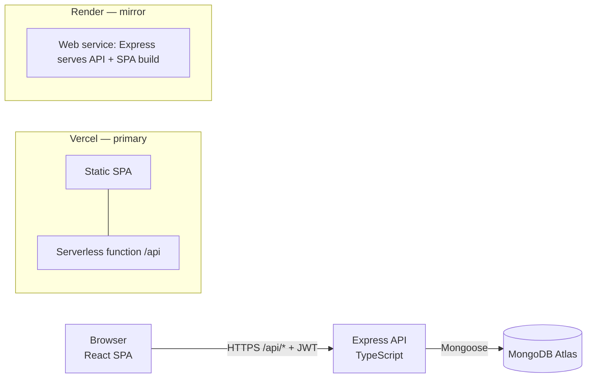

# 05 · Architecture

## Overview

- **Monorepo** with two packages: `client/` (React) and `server/` (Express). One repository, one PR flow.
- Same-origin `/api` on both platforms → no CORS problems in production; CORS allow-list only for local dev.
- **Vercel (primary, required by the M3 rubric):** SPA served as static files; `server/` exported as a serverless function mounted at `/api/*`.
- **Render (second platform, professor's requirement):** one web service that runs the same Express app and also serves `client/dist`. Same database.

## Stack (current, maintained versions)
| Layer | Choice | Why |
|---|---|---|
| Language | TypeScript 6 (strict) in client and server | Course Sem 14; fewer contract mistakes |
| Frontend | React 18 + Vite, React Router 7 (library mode), Tailwind CSS 4 | Course stack (Sem 4, 8–10) |
| Data fetching | Custom hooks (`useApi`, `usePolling`) over `fetch` | Rubric M2 asks for a custom hook the team can explain |
| Charts | Recharts | Simple daily sales / best sellers charts |
| Backend | Node 20 + Express 4 | Course stack (Sem 11) |
| Database | MongoDB Atlas + Mongoose 8 | Course stack (Sem 12) |
| Auth | jsonwebtoken (HS256, 15 min, iss/aud), bcrypt (cost 12) | Course JWT class |
| Validation | zod 4 (schemas mirror `openapi.yaml`) | Reject bad input with clear 400s |
| Security | helmet, express-rate-limit, express-mongo-sanitize, cors | Rubric M3 security audit |
| API docs | Swagger UI (pinned, from cdnjs) rendering `docs/spec/openapi.yaml` at `/api/docs`; raw spec at `/api/docs/openapi.json` | Integration contract in Swagger |
| Tests | Vitest + Supertest (API), mongodb-memory-server | Unit + integration pyramid from class |
| CI | GitHub Actions: lint, type-check, test | DoD |

## Folder structure
```
/
├─ client/                     React app
│  └─ src/
│     ├─ api/                  fetch wrapper + typed endpoint functions
│     ├─ hooks/                useAuth, useApi, usePolling, useForm
│     ├─ context/              AuthContext
│     ├─ components/           reusable UI (≤80 lines each)
│     ├─ layouts/              AppLayout (sidebar by role), AuthLayout
│     ├─ pages/                one folder per feature (inventory, sales, orders, ...)
│     ├─ routes/               router + ProtectedRoute(roles)
│     └─ types/                shared TS types (match openapi.yaml)
├─ server/
│  └─ src/
│     ├─ app.ts                express app (middleware chain)
│     ├─ index.ts              local / Render entry (listen)
│     ├─ config/               env loading + validation
│     ├─ db/                   mongoose connection (cached for serverless)
│     ├─ models/               Mongoose schemas
│     ├─ middleware/           authenticate, authorize, validate, errorHandler
│     ├─ modules/<feature>/    router.ts · service.ts · schemas.ts
│     ├─ utils/                errors, jwt, password, validation
│     └─ docs/                 serves openapi.yaml at /api/docs
│  ├─ scripts/demo.ts          `npm run demo`: in-memory DB + seeded data
│  └─ test/                    Vitest + Supertest
├─ api/index.ts                Vercel serverless entry → server app
├─ docs/                       spec, brief, AI log
└─ .github/workflows/ci.yml
```
Backend layering: **router** (paths, `authenticate`, `authorize(roles)`, validation, HTTP in/out) → **service** (business rules BR1–BR8, testable without HTTP) → **model**. A separate controller layer was dropped as unnecessary: routers stay thin.

## Middleware chain (order matters)
`helmet` → `cors` (dev only) → `express.json({ limit: '100kb' })` → `mongoSanitize` → request logging → routes (`rateLimit` on `/auth/*`) → `authenticate` → `authorize(roles)` → `validate(zodSchema)` → route handler → service → `notFound` → `errorHandler` (maps errors to the `Error` schema, hides stack traces in production).

## Security checklist (maps to HW15 / M3)
- JWT: secret ≥256 bits in env, `algorithms: ['HS256']` fixed, `issuer` + `audience` validated, 15 min expiry, minimal payload `{ sub, role, orgId, orgType }`, never in URLs.
- Token stored in memory + `sessionStorage` (accepted trade-off documented: XSS risk mitigated by React escaping, no `dangerouslySetInnerHTML`, CSP from helmet).
- Passwords: bcrypt cost 12; same error for wrong email / wrong password; rate limit 5 failed logins / 15 min.
- Authorization in backend on every route: role check + `orgId` ownership check in every query.
- Input: zod validation + length limits; `express-mongo-sanitize`; Mongoose `sanitizeFilter` + `strictQuery` (server-built operators wrapped in `mongoose.trusted()`); body size limit.
- Output: never return `passwordHash`; generic 500 messages in production.
- Headers: helmet defaults (CSP, HSTS, noSniff, frameguard).
- Secrets: `.env` git-ignored; `.env.example` committed; platform env vars on Vercel and Render.
- Dependencies: `npm audit` clean of high/critical before delivery.

## Environment variables
| Name | Where | Example |
|---|---|---|
| `MONGODB_URI` | server | `mongodb+srv://…` (Atlas) |
| `JWT_SECRET` | server | 64 hex chars (`crypto.randomBytes(32)`) |
| `JWT_ISSUER` / `JWT_AUDIENCE` | server | `conecta-negocio-auth` / `conecta-negocio-api` |
| `NODE_ENV` | server | `production` |
| `CORS_ORIGIN` | server (dev) | `http://localhost:5173` |
| `VITE_API_URL` | client | `/api` |

## Delivery plan
The original day-by-day plan was superseded; current progress and the remaining plan are in [`docs/status.md`](../status.md).
