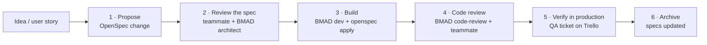

# Team workflow: OpenSpec + BMAD

How the team goes from an idea to a feature running in production. **OpenSpec** owns *what* we build and lets the team agree on it before coding; **BMAD** provides the agent roles that *build, review and verify* it. Git is trunk-based: every step lands on `main` through a reviewed PR with green CI.



## Where things live
| Path | What | Owner |
|---|---|---|
| `docs/spec/` | Product-level spec: scope, roles, user stories, data model, `openapi.yaml` contract, architecture, screens | Whole team |
| `openspec/specs/` | **Source of truth** of how the system behaves today (one folder per capability) | Updated only by archiving changes |
| `openspec/changes/<change>/` | A proposed change: `proposal.md` (why/what), `specs/` (requirement deltas with scenarios), `design.md` (how), `tasks.md` (checklist) | Author of the change |
| `openspec/config.yaml` | Project rules every change must follow | Team |
| `_bmad/` + `.claude/skills/bmad-*` | BMAD agents and workflows for Claude Code | Installed with `npx bmad-method install` |
| Trello | One card per change and per QA ticket (lists: Backlog → To Do → In Progress → Code Review → Verification → Done) | Team |

## The six steps

### 1 · Propose (OpenSpec)
Anyone on the team can propose a change.
- In Claude Code: `/openspec-propose "<idea>"`, or by hand: `npx openspec new change add-<thing>` and fill in the four files.
- Branch `spec/<change>`, PR titled `spec: <change>`. CI runs `npm run spec:validate` (strict OpenSpec validation).
- Claim the change in the board below (put your name as Owner) in the same PR.

### 2 · Review the spec (team + BMAD)
- **A different teammate** reviews the proposal PR: are the scenarios testable? Do they match the permission matrix and `openapi.yaml`?
- Optional agent help: `bmad-agent-architect` (Winston) checks `design.md` against `docs/spec/05-architecture.md`; `bmad-review` runs an adversarial / edge-case review of the spec.
- Merge = the team agreed on the behavior. No code is written for a change that is not merged.

### 3 · Build (BMAD + OpenSpec apply)
- Branch `feature/<change>`.
- `bmad-build` (or `bmad-agent-dev`, Amelia) implements the work; `/openspec-apply-change <change>` walks `tasks.md` and ticks each task only when its verification passes.
- Each task group ships its own Vitest/Supertest tests and Swagger updates (rule in `openspec/config.yaml`).

### 4 · Code review
- `bmad-code-review` runs several independent reviewers on the diff and triages findings.
- A teammate reviews the PR on GitHub. CI (lint, typecheck, tests, spec validation, build, audit) must be green before merging.
- `bmad-walkthrough` explains the change for whoever needs to present it at Demo Day.

### 5 · Verify in production
- After merge, Vercel and Render deploy `main`.
- Run the change's QA ticket(s) on **both** production URLs; attach evidence to the Trello card and move it to Done.
- `bmad-qa-generate-e2e-tests` can add automated API/e2e tests for the verified flow.

### 6 · Archive
- `/openspec-archive-change <change>` (or `npx openspec archive <change>`) merges the deltas into `openspec/specs/` and moves the change to `openspec/changes/archive/`.
- Add the entry to `docs/ai-log.md`. At the end of an epic, `bmad-retrospective` can review what happened.

## Traceability
Every piece of work is linked end to end, so any line of code can be traced back to its requirement:

**Trello card ↔ GitHub issue ↔ branch ↔ PR ↔ OpenSpec change ↔ QA ticket**

- **Board:** [Trello — Conecta Negocio](https://trello.com/b/eW3qMZpU/conecta-negocio-dsaw-final-project). Card names start with the issue number and priority, e.g. `#14 [P0] Product inventory… (add-product-inventory)`; the description links the issue, branch and OpenSpec folder.
- **Issues:** [GitHub issues](https://github.com/JoseAlejandroMeloM/NO-ENTREGA-Proyecto-M3-DW/issues), milestone *Final delivery (Nov 19)*. One issue per OpenSpec change (#11–#26), one per QA ticket (QA-01–25 = #27–#51), and #7–#10 for the setup work.
- **Branches:** each change already has its branch, linked to its issue (`feature/<change>`; `chore/add-production-release`). Start from it — don't create a new one: `git switch feature/<change> && git merge main`.
- **PRs:** title `feat: <change>`, body contains `Closes #<issue>` so merging closes the issue. Branches are **kept after merge** (repo setting `delete_branch_on_merge` off) as history.
- **Cards move with the work:** To Do → In Progress (first commit) → Code Review (PR opened) → Verification (merged; run QA cards) → Done (QA passed in production, change archived).
- **QA tickets** record their evidence as a comment on the GitHub issue, then the issue is closed and the card moved to Done.

## Change board
Order = suggested build order (each change lists its dependencies in `proposal.md`). **Archive in this order** too, because later changes add requirements to capabilities created by earlier ones (e.g. `notifications`).

| # | Change | Issue | Priority | Stories | QA | Owner | Status |
|---|---|---|---|---|---|---|---|
| 1 | `add-identity-access` | [#11](https://github.com/JoseAlejandroMeloM/NO-ENTREGA-Proyecto-M3-DW/issues/11) | P0 | US-01–03, TS-02 | QA-01–03, 23 | Jose | Built — QA in production pending |
| 2 | `add-team-management` | [#12](https://github.com/JoseAlejandroMeloM/NO-ENTREGA-Proyecto-M3-DW/issues/12) | P0 | US-04 | QA-04 | Jose | Built — QA in production pending |
| 3 | `add-notifications` | [#13](https://github.com/JoseAlejandroMeloM/NO-ENTREGA-Proyecto-M3-DW/issues/13) | P0 | US-41 | QA-21 | Jose | Built — QA in production pending |
| 4 | `add-product-inventory` | [#14](https://github.com/JoseAlejandroMeloM/NO-ENTREGA-Proyecto-M3-DW/issues/14) | P0/P1 | US-10–12 | QA-05–07 | Jose | Built — QA in production pending |
| 5 | `add-sales-register` | [#15](https://github.com/JoseAlejandroMeloM/NO-ENTREGA-Proyecto-M3-DW/issues/15) | P0 | US-20–22 | QA-10–12 | Jose | Built — QA in production pending |
| 6 | `add-sales-insights` | [#16](https://github.com/JoseAlejandroMeloM/NO-ENTREGA-Proyecto-M3-DW/issues/16) | P0 | US-13–14 | QA-08–09 | Jose | Built — QA in production pending |
| 7 | `add-distributor-catalog` | [#17](https://github.com/JoseAlejandroMeloM/NO-ENTREGA-Proyecto-M3-DW/issues/17) | P0 | US-30–31 | QA-13–14 | Jose | Built — QA in production pending |
| 8 | `add-purchase-orders` | [#18](https://github.com/JoseAlejandroMeloM/NO-ENTREGA-Proyecto-M3-DW/issues/18) | P0/P1 | US-32–36 | QA-15–19 | Jose | Built — QA in production pending |
| 9 | `add-order-messaging` | [#19](https://github.com/JoseAlejandroMeloM/NO-ENTREGA-Proyecto-M3-DW/issues/19) | P1 | US-40 | QA-20 | Jose | Built — QA in production pending |
| 10 | `add-production-release` | [#20](https://github.com/JoseAlejandroMeloM/NO-ENTREGA-Proyecto-M3-DW/issues/20) | P0 | TS-02, 03, 05–07 | QA-22–25 | — | Proposed |
| 11 | `add-sale-voiding` | [#21](https://github.com/JoseAlejandroMeloM/NO-ENTREGA-Proyecto-M3-DW/issues/21) | P2 additional | BR2 | — | — | Proposed |
| 12 | `add-cash-register-closing` | [#22](https://github.com/JoseAlejandroMeloM/NO-ENTREGA-Proyecto-M3-DW/issues/22) | P2 additional | — | — | — | Proposed |
| 13 | `add-shipment-tracking-details` | [#23](https://github.com/JoseAlejandroMeloM/NO-ENTREGA-Proyecto-M3-DW/issues/23) | P2 additional | — | — | — | Proposed |
| 14 | `add-restock-alerts` | [#24](https://github.com/JoseAlejandroMeloM/NO-ENTREGA-Proyecto-M3-DW/issues/24) | P2 additional | — | — | — | Proposed |
| 15 | `add-sales-export` | [#25](https://github.com/JoseAlejandroMeloM/NO-ENTREGA-Proyecto-M3-DW/issues/25) | P2 additional | — | — | — | Proposed |
| 16 | `add-distributor-insights` | [#26](https://github.com/JoseAlejandroMeloM/NO-ENTREGA-Proyecto-M3-DW/issues/26) | P2 additional | — | — | — | Proposed |

Not an OpenSpec change (no behavior change): **visual design passes 1–6**, presentation only, one `feature/ui-<pass>` branch and PR each — plan and rules in `docs/design-brief.md`, progress in `docs/status.md`.

Baseline already in `openspec/specs/`: `platform-foundation` (health check, contract, error format, security headers, SPA hosting) — delivered by the scaffold.

## Useful commands
```bash
npm run spec:list                 # changes and task progress
npm run spec:validate             # strict validation (also in CI)
npx openspec show add-sales-register
npx openspec view                 # interactive dashboard
```
In Claude Code: `/openspec-propose`, `/openspec-explore`, `/openspec-apply-change`, `/openspec-archive-change`, and `bmad-help` to ask BMAD what to do next.
